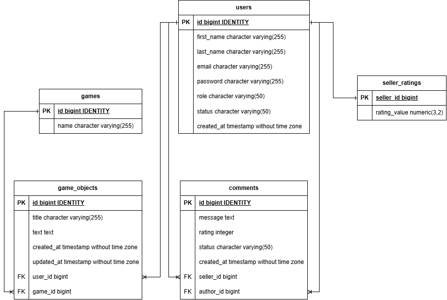

# 🏆 Seller Rating System


**Seller Rating System** is a RESTful API service for independent evaluation of game item sellers (CS2, Dota 2, Minecraft, etc.). 

The system ensures trust by allowing users (including anonymous guests) to leave comments and ratings, which are strictly moderated and verified by administrators before publication.

This project is built on **Spring Framework 6** (without Spring Boot).

---

## 📑 Table of Contents
- [Tech Stack](#-tech-stack)
- [Architecture & Database](#-architecture--database)
- [Quick Start (Docker)](#-quick-start-docker)
- [System Initialization](#-system-initialization)
- [API Documentation & Testing](#-api-documentation--testing)
- [Usage Scenarios (User Flow)](#-usage-scenarios-user-flow)

---

## 🛠 Tech Stack

The project uses a modern Java development stack:

* **Core:** Java 21, Spring Framework 6 (MVC, Security, Context, Data JPA)
* **Database:** PostgreSQL 15
* **Migration:** Liquibase (Database schema management)
* **Caching:** Redis (Lettuce client)
* **Security:** JWT (Access Tokens), BCrypt, Role-Based Access Control (RBAC)
* **Testing:** JUnit 5, Mockito, **Testcontainers** (Real PostgreSQL in tests)
* **DevOps:** Docker, Docker Compose, Tomcat 10
* **Build Tool:** Maven (WAR packaging)

---

## 🗄 Architecture & Database

The database is fully normalized and designed to ensure data integrity.



**Key Entities:**
* `users`: Stores Administrators and Sellers.
* `games`: Pre-installed game categories (CS2, Dota 2, etc.).
* `game_objects`: Items (inventory) created by sellers.
* `comments`: Reviews left by users or guests.
* `seller_ratings`: Denormalized average rating value (stored separately to optimize read performance).

---

## 🚀 Quick Start (Docker)

The best way to run the application is using Docker Compose. This ensures the App, Database, and Cache run in a perfectly configured environment.

### Prerequisites
* Docker Desktop (installed and running).
* Postman (for API testing).

### Instructions
1.  **Open a terminal** in the project root folder (where `docker-compose.yml` is located).
2.  Create the `.env` file or the `environment` section in `docker-compose.yml`.
3.  **Build and Run:**
    ```bash
    docker-compose up --build
    ```
    This command compiles the Java code, builds the WAR file, and sets up the network.

4.  **Wait for startup.** You should see `Artifact is deployed successfully` in the logs.
5.  The API is available at: `http://localhost:8080/seller-rating-system/`.

---

## ⚡ System Initialization

To avoid working with an empty database, the system runs `Initializers` (Data Seeding) on the first start:

1.  **Liquibase** creates the table structure.
2.  **AdminInitializer** creates a Super-Admin (admin registration via API is disabled):
    > **Login:** `admin@rating.com`
    >
    > **Password:** `admin123`
3.  **GameInitializer** fills the catalog with popular games: *Counter-Strike 2, Dota 2, Minecraft, FIFA 24, Rust, Valorant, Team Fortress 2*.

---

## 🧪 API Documentation & Testing

### Postman
A complete collection for testing all scenarios is included in the repository:
* 📥 **Collection:** `docs/postman/Rating System API.postman_collection.json`
* 🌍 **Environment:** `docs/postman/Rating System Local.postman_environment.json`

### Automated Tests (Local)
The project is covered by Unit and Integration tests. Integration tests use **Testcontainers** to spin up a real PostgreSQL instance in Docker, ensuring 100% production compatibility.

To run tests:
```bash
mvn test
```

## 🔄 Usage Scenarios (User Flow)

It is recommended to run requests in the Postman collection in order, as they follow a logical chain:

### 1. Auth & Setup
1.  **Login** as the Super-Admin (credentials above) to get your first token.
2.  Send a request to register a new **Seller**.
3.  > **Important:** The system sends a real confirmation email. **Check your inbox** (or Spam folder) for the activation link. You must click this link to verify your account. Without this, the seller cannot log in.

### 2. Admin Workflow
1.  Use the Admin token to call the `Approve Seller` endpoint. Only after approval does the seller status change to `ACTIVE`.
2.  The Admin can also view all comments and change their status from `PENDING` to `APPROVED` (moderation).

### 3. Seller Workflow
1.  **Login** as the approved (`Active`) Seller.
2.  Create items (`Game Objects`) in your inventory and link them to games.

### 4. Public & Guests
1.  View the public seller catalog (filtering by rating and games is available).
2.  Leave comments for sellers (as an Anonymous Guest). The comment will get a `PENDING` status and will not affect the rating until approved by an Admin.
3.  If a seller does not exist, you can submit a request to create one (Anonymous Request).